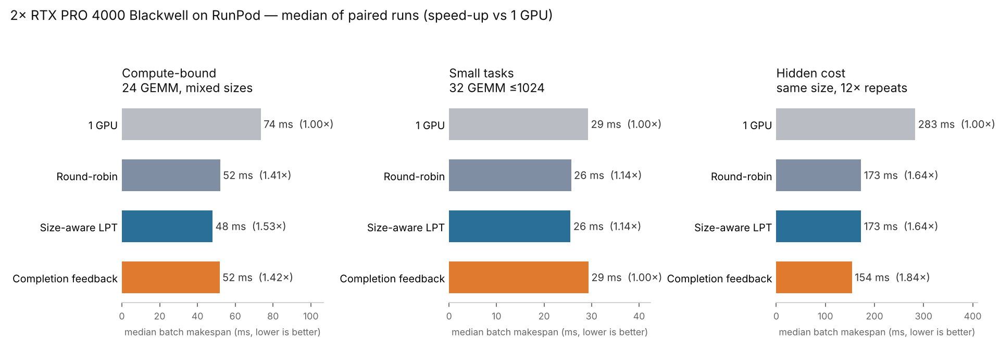
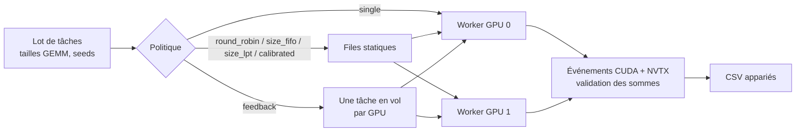

# Ordonnancement adaptatif de tâches CUDA sur deux GPU cloud

**Quand un ordonnanceur « intelligent » bat-il vraiment le round-robin en multi-GPU ?** Banc d'essai contrôlé de six politiques d'affectation sur deux NVIDIA RTX PRO 4000 Blackwell (RunPod), avec exécutions appariées et randomisées, et données brutes publiées.

[](https://github.com/Matt95354855/Adaptive-Scheduling-of-CUDA-Tasks-on-Two-Cloud-GPUs/actions/workflows/ci.yml)    

[English](README.md) · [Français](README.fr.md)



## Résultats clés

Analyse appariée sur 12 ordres de tâches indépendants par charge (8 pour les transferts) (`experiments/analyze.py`), écart face au round-robin avec IC bootstrap à 95 % :

| Charge | Meilleure politique | Accélération vs 1 GPU | vs round-robin | Ordres gagnés |
|---|---|---:|---:|---:|
| 24 GEMM orientés calcul, tailles mixtes | **LPT par taille** (statique, connaît `n³`) | **1,53×** | **−7,2 %** [−10,0 ; −4,0] | 12/12 |
| 32 petits GEMM (≤ 1024) | Round-robin (statique) | 1,13× | retour de fin **+12,5 %** plus lent [+9,6 ; +15,7] | — |
| Tâches de même taille à coût caché (12 répétitions) | **Retour de fin de tâche** | **1,84×** | −10,9 % [−16,1 ; +2,5] | 8/12 |
| 24 tâches H2D + GEMM, entrées épinglées allouées par tâche | **1 GPU** | — | −23,1 % [−32,8 ; −13,9] | 8/8 |
| Mêmes copies, entrées épinglées réutilisées | **Round-robin** | 1,31× | 1 GPU **+35,9 %** plus lent [+28,0 ; +39,2] | 8/8 |

- **Le nombre de tâches est un mauvais indicateur d'équilibre.** Le round-robin donne 12 tâches à chaque GPU mais un déséquilibre de 1,39× en travail `n³` ; la politique calibrée par modèle de coût le ramène à 1,06×.
- **Le retour réactif n'est rentable que si les durées sont imprévisibles** — et même là, le gain n'est pas encore statistiquement établi (l'IC traverse zéro). Quand les métadonnées prédisent le coût, une partition statique par taille gagne sans surcoût d'orchestration.
- **Avec des transferts hôte→GPU, la durée de vie des entrées décide du gagnant.** Allouer la mémoire hôte épinglée dans chaque tâche rend deux GPU *plus lents* qu'un seul (−23 % pour un seul GPU) ; réutiliser les tampons épinglés avec les mêmes copies inverse le résultat (un seul GPU devient 36 % plus lent que le round-robin). Les temps GEMM et H2D sont quasi identiques entre politiques : le goulot est l'allocation côté hôte.
- **Sur les petites tâches, l'hôte domine** : les noyaux CUDA représentent ~3–4 ms d'un lot de 25–30 ms ; allocations et messages inter-processus font le résultat.
- Exécutions cloud sous un **plafond strict de 2 $** par session (pilote : 0,25 $) ; toutes les sommes de contrôle validées ; la CI relance l'analyse appariée sur toutes les données publiées.

## Méthode



- Six politiques : `single`, `round_robin`, `size_fifo`, `size_lpt`, `calibrated` (modèle de coût par GPU issu des événements CUDA), `feedback`.
- Chaque bloc `(seed, répétition)` exécute toutes les politiques dans un **ordre randomisé** pour neutraliser la dérive ; 12 seeds × 2–3 répétitions par charge.
- Processus `spawn` neufs, warm-up et calibration hors fenêtre mesurée ; trace Nsight Systems du smoke test.
- Protocole pré-enregistré : la charge à coût caché a été documentée **avant** d'être mesurée.

## Démarrage rapide

Nécessite PyTorch avec CUDA et deux GPU NVIDIA visibles.

```bash
bash experiments/diagnose.sh                       # topologie GPU, pilote, CUDA
python experiments/pilot.py --smoke --out results/smoke.json
python experiments/study.py --workload compute --out results/compute.json        # étude appariée, ordre randomisé
python experiments/analyze.py results/compute-paired-2026-10-20.csv              # analyse appariée des données publiées
```

## Structure du dépôt

```text
experiments/   banc d'essai (pilot.py, study.py), métriques, analyses, diagnostic
results/       CSV appariés par exécution, synthèses d'équilibre et de diagnostic (20/10/2026)
docs/          protocoles, observations et limites, figures
```

## Limites

Une seule instance, GPU identiques en PCIe (sans NVLink), tâches indépendantes, 8 à 12 ordres de tâches par charge. Les JSON par tâche et les traces Nsight binaires étaient sur un stockage éphémère ; les résultats appariés et les agrégats de traces sont conservés. Ces résultats décrivent cette implémentation, pas les ordonnanceurs en général. Suite : localité des données entre GPU, charges en DAG, échantillons plus larges.

## Documentation

- [Résultats des transferts hôte→GPU et analyse Nsight](docs/transfer-results-2026-10-21.md)
- [Résultats de l'étude de suivi, post-analyse et synthèse Nsight](docs/followup-results-2026-10-20.md)
- [Protocole de l'étude de suivi](docs/followup-protocol-2026-10-20.md) · [Protocole du pilote](docs/protocol.md)
- [Observations et limites du pilote](docs/observations-2026-10-20.md)
- Données brutes : [`results/`](results/)

## Licence

MIT — voir [LICENSE](LICENSE).
