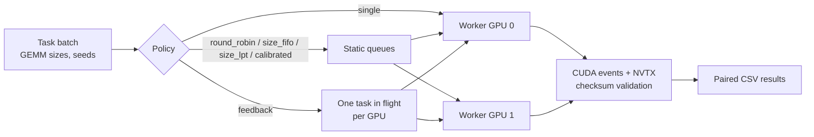

# Adaptive Scheduling of CUDA Tasks on Two Cloud GPUs

**When does a smarter scheduler actually beat round-robin on multi-GPU?** A controlled benchmark of six task-assignment policies on two NVIDIA RTX PRO 4000 Blackwell GPUs (RunPod), with paired, randomized runs and published raw data.

   

[English](README.md) · [Français](README.fr.md)


## Key findings

Paired analysis over 12 independent task orders per workload (`experiments/analyze.py`), change vs round-robin with 95 % bootstrap CI:

| Workload | Best policy | Speed-up vs 1 GPU | vs round-robin | Orders won |
|---|---|---:|---:|---:|
| 24 compute-bound GEMMs, mixed sizes | **Size-aware LPT** (static, knows `n³`) | **1.53×** | **−7.2 %** [−10.0, −4.0] | 12/12 |
| 32 small GEMMs (≤ 1024) | Round-robin (static) | 1.13× | completion feedback **+12.5 %** slower [+9.6, +15.7] | — |
| Same-size tasks with hidden cost (12× repeats) | **Completion feedback** | **1.84×** | −10.9 % [−16.1, +2.5] | 8/12 |

- **Task count is a poor balance metric.** Round-robin gave each GPU 12 tasks but a 1.39× imbalance in `n³` work; the calibrated cost-model policy brought it to 1.06×.
- **Reactive feedback only pays off when durations are unpredictable** — and even then the gain is not yet statistically conclusive (CI crosses zero). When metadata predicts cost, a static size-aware partition wins with zero orchestration overhead.
- **On small tasks the host dominates**: CUDA kernels account for ~3–4 ms of a 25–30 ms batch; allocations and inter-process messaging decide the result.
- Cloud runs under a hard **$2 spending cap** (pilot: $0.25); every output checksum validated.

## Method



- Six policies: `single`, `round_robin`, `size_fifo`, `size_lpt`, `calibrated` (per-GPU cost model from CUDA events), `feedback`.
- Each `(seed, repetition)` block runs all policies in a **randomized order** to cancel drift; 12 seeds × 2–3 repetitions per workload.
- Fresh `spawn` processes, warm-up and calibration outside the timed window; Nsight Systems trace of the smoke test.
- Pre-registered protocol: the hidden-cost workload was documented **before** it was measured.

## Quick start

Requires CUDA-enabled PyTorch and two visible NVIDIA GPUs.

```bash
bash experiments/diagnose.sh                       # GPU topology, driver, CUDA check
python experiments/pilot.py --smoke --out results/smoke.json
python experiments/study.py --workload compute --out results/compute.json        # paired study, randomized policy order
python experiments/analyze.py results/compute-paired-2026-10-20.csv              # paired analysis of published data
```

## Repository structure

```text
experiments/   benchmark runner (pilot.py, study.py), metrics and analysis scripts, diagnostics
results/       paired per-run CSVs and balance / diagnostic summaries (2026-10-20)
docs/          protocols, observations and limitations, figures
```

## Limitations

Single instance, identical GPUs over PCIe (no NVLink), independent tasks already resident on each GPU. These results describe this implementation, not schedulers in general.

**In progress — host-to-device transfers.** A pre-registered `transfer` workload (pinned host inputs copied to the selected GPU, H2D and GEMM timed separately) has been smoke-tested on 2026-10-21: [results](results/transfer-smoke-metrics-2026-10-21.csv). The full paired campaign, inter-GPU data locality and DAG workloads come next.

## Documentation

- [Follow-up results, post-analysis and Nsight summary](docs/followup-results-2026-10-20.md) (FR)
- [Follow-up protocol](docs/followup-protocol-2026-10-20.md) (FR) · [Pilot protocol](docs/protocol.md) (FR)
- [Pilot observations and limitations](docs/observations-2026-10-20.md) (FR)
- Raw data: [`results/`](results/)

## License

MIT — see [LICENSE](LICENSE).
