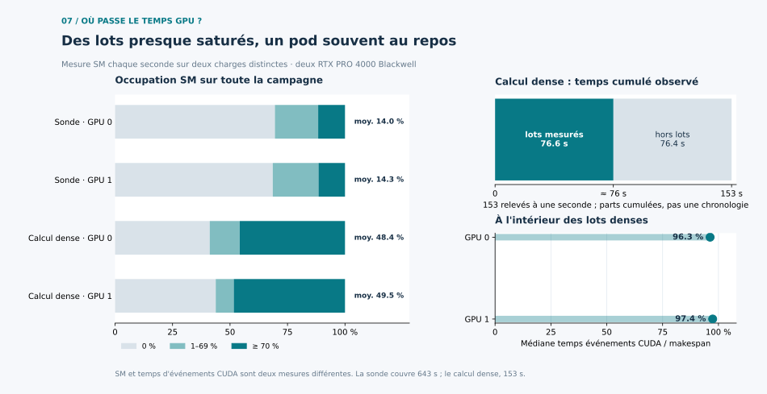
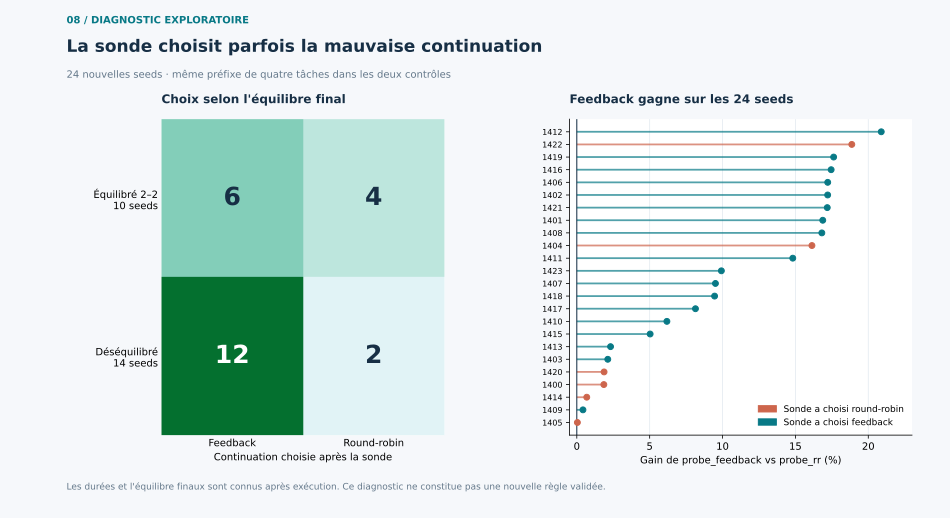

# Deux nouvelles lectures des résultats, 24 octobre 2026

Ces figures réanalysent les fichiers bruts déjà publiés. Elles n'ajoutent aucun run GPU et ne changent aucun critère des protocoles prospectifs. Les graphiques sont produits par [ce script Matplotlib](../experiments/plot_new_observations.py).

## 1. Les GPU travaillent pendant les lots, mais attendent entre les lots

La [figure 07](../figures/07_occupation_gpu_deux_echelles.svg) distingue le compteur d'occupation SM échantillonné chaque seconde et les durées d'événements CUDA rapportées au makespan de chaque lot. Ce sont deux mesures différentes.

| Charge | GPU 0 : moyenne SM | GPU 1 : moyenne SM | Relevés à zéro, GPU 0 / 1 |
| --- | ---: | ---: | ---: |
| Sonde en ligne, 643 relevés | 13,99 % | 14,29 % | 69,52 % / 68,58 % |
| Calcul dense, 153 relevés | 48,37 % | 49,47 % | 41,18 % / 43,79 % |

Pour le calcul dense, les **16 fenêtres chronométrées totalisent 76,57 s**. Le journal contient **153 relevés à une seconde** : environ **76,4 s sont hors fenêtres chronométrées**. Ce solde comprend notamment le démarrage des workers PyTorch, leur calibration, les écritures et les intervalles entre runs ; les données disponibles ne permettent pas d'attribuer exactement chaque seconde à l'une de ces opérations. Dans une fenêtre chronométrée, la médiane des durées d'événements CUDA GEMM rapportées au makespan atteint **96,27 % sur GPU 0** et **97,41 % sur GPU 1**. Cela décrit une tâche lourde bien alimentée pendant le lot, sans impliquer une occupation SM moyenne de 96–97 % sur le pod facturé.

**Nouvelle conclusion pratique :** rallonger les tâches améliore nettement l'occupation de campagne, mais ne suffit pas à atteindre 70 % en moyenne tant que les workers et la calibration sont recréés à chaque run. Un futur pool persistant doit être jugé sur la durée complète de la campagne, avec le même échantillonnage SM. Le journal de la sonde commence après le lancement de cette campagne ; ses 643 relevés ne constituent donc pas sa durée totale et ne sont pas utilisés pour une décomposition du temps comme celle du calcul dense.

## 2. Le signal de la sonde ne sélectionne pas la meilleure continuation observée

La [figure 08](../figures/08_sonde_decisions_et_controles.svg) relie le choix en ligne à l'équilibre final, connu seulement après exécution. Sur les 24 seeds, round-robin finit équilibré 2–2 dans 10 cas et déséquilibré dans 14. La sonde choisit feedback dans **12/14** cas déséquilibrés, mais aussi **6/10** cas équilibrés ; elle choisit round-robin dans les quatre autres cas équilibrés et deux cas déséquilibrés.

La comparaison décisive est entre `probe_feedback` et `probe_rr`, qui subissent **la même pause après les quatre premières tâches**. `probe_feedback` est plus rapide sur **24/24 seeds** ; son avantage médian descriptif est **9,72 %** par rapport à `probe_rr`. Les six décisions de poursuivre en round-robin ne rejoignent donc jamais la meilleure continuation mesurée pour leur seed. Parmi elles, les seeds **1404** et **1422** présentent respectivement **16,13 %** et **18,87 %** d'avantage observé pour le contrôle `probe_feedback`.

**Nouvelle conclusion méthodologique :** le déséquilibre final explique une partie de l'effet de feedback dans les validations a posteriori, mais ce classement n'est pas un critère de sélection suffisant pour une politique en ligne avec pause. La règle de quatre tâches échoue à son [test prospectif principal](online-probe-results-2026-10-24.md) : `probe_switch` vs `probe_feedback` = **−0,12 %**, IC bootstrap 95 % **[−0,59 ; +0,23]**. Les 24 comparaisons par seed de la figure 08 sont un diagnostic exploratoire sur le même échantillon, et ne valident pas une nouvelle règle.

## Données et reproduction

- [Télémétrie brute de la sonde](../results/online-probe-gpu-util-2026-10-24.log) et [résumé](../results/online-probe-utilization-summary-2026-10-24.json)
- [Télémétrie brute du calcul dense](../results/sustained-gpu-util-2026-10-24.log), [résumé](../results/sustained-utilization-summary-2026-10-24.json) et [durées des 16 runs](../results/sustained-2026-10-24.csv)
- [Décisions et temps par seed](../results/online-probe-route-diagnostics-2026-10-24.csv), [JSON brut des 240 runs](../results/online-probe-2026-10-24.json)
- [Script des deux nouvelles figures](../experiments/plot_new_observations.py)
