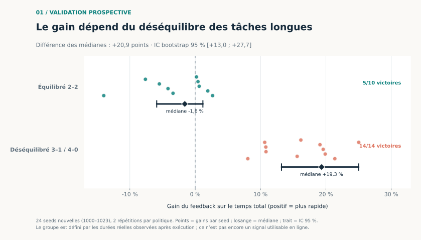
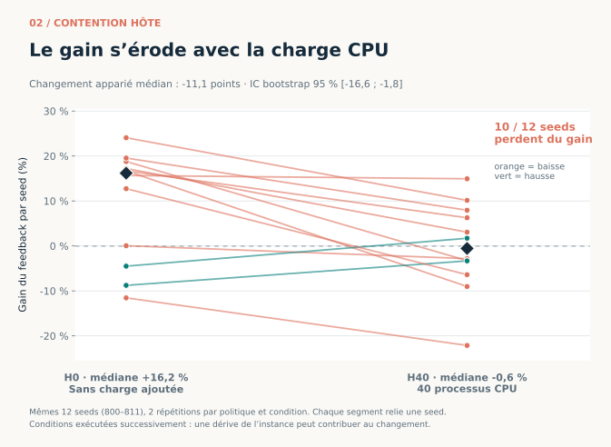
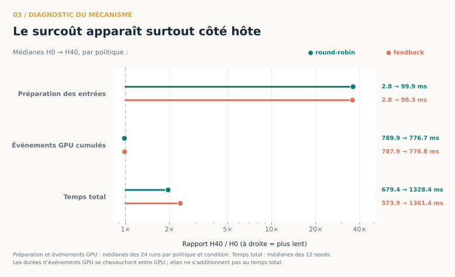

# Conclusions illustrées de la campagne du 23 octobre 2026

Les trois figures ci-dessous sont produites par [`experiments/plot_research.py`](../experiments/plot_research.py) à partir des CSV et JSON publiés dans `results/`. Le script utilise `matplotlib.pyplot`, ne lance aucune expérience et ne nécessite pas de GPU. Les versions SVG sont vectorielles ; les versions PNG servent à l'aperçu.

## 1. Le gain est conditionnel, confirmé sur de nouvelles seeds



Le protocole avait été fixé avant les seeds 1000–1023. Lorsque l'affectation statique place les quatre tâches longues de manière déséquilibrée, le feedback gagne sur **14/14 seeds**, avec une médiane de **+19,34 %** et un IC bootstrap 95 % de **[+13,20 ; +25,02] %**. Lorsque l'affectation est déjà équilibrée, la médiane est **−1,60 %** sur 10 seeds et l'IC **[−5,89 ; +1,18] %** recouvre zéro. La différence des médianes, critère principal préenregistré, est **+20,94 points** avec IC **[+13,02 ; +27,66]** : le critère de validation est atteint sur cette charge et cette instance.

L'interprétation du gain global demande de regarder la composition des ordres : la première série H0 ne comptait que 4/12 seeds équilibrées, contre 9/12 dans la réplication ; celle-ci n'a pas reproduit le gain global initial. La série prospective compte 10/24 seeds équilibrées. Une médiane globale change donc lorsque cette proportion change, même si la relation conditionnelle reste présente.

**Limite décisive :** le classement 2–2, 3–1 ou 4–0 repose sur les durées réelles connues après exécution. La figure valide une relation diagnostique ; elle ne démontre pas encore qu'un planificateur puisse reconnaître ce régime en ligne.

## 2. La contention hôte réduit l'avantage observé



Les mêmes 12 seeds sont comparées sans charge CPU ajoutée (H0) et avec 40 processus concurrents (H40). Le gain médian du feedback passe de **+16,18 %** à **−0,56 %**. Cette différence de médianes ne doit pas être confondue avec le critère apparié : la **médiane des changements par seed** vaut **−11,09 points**, IC bootstrap 95 % **[−16,64 ; −1,80]**, et 10/12 seeds perdent du gain. Cela soutient une érosion de l'avantage dans cette configuration.

Le bloc H0 initial n'était pas robuste à lui seul, et sa réplication sans contention a donné **−1,16 %** de gain médian. Les conditions H0/H40 ont été exécutées successivement sur une seule instance ; une dérive temporelle ne peut pas être exclue. L'effet H40 mérite une réplication avec ordre des conditions alterné.

## 3. Le ralentissement est cohérent avec un goulot côté hôte



La médiane du temps de préparation des entrées par tâche passe d'environ **2,8 ms** à **98–100 ms** entre H0 et H40, soit environ **35–36 fois** plus. Le temps total par seed est multiplié par environ **2,0** pour round-robin et **2,4** pour feedback. En revanche, la somme des événements GPU par run reste près de **777–790 ms** dans les deux conditions. Le compteur cgroup `nr_throttled` a augmenté de 103 à 932 pendant H40, pour un quota de 20,4 cœurs et 40 processus de charge. L'ensemble est cohérent avec un manque de capacité côté hôte qui retarde la préparation et l'alimentation des GPU.

La trace Nsight ciblée sur la seed 801 va dans le même sens : **344 GEMM principaux** dans chaque condition, pour **1 667,6 ms** de kernels cumulés en H0 contre **1 648,2 ms** en H40 ; les **88 copies H2D** totalisent **288,1 ms** puis **249,1 ms**. Ces totaux incluent la calibration et les deux politiques, et ne sont pas une décomposition du makespan. La trace ne prouve pas à elle seule la part causale du CPU. Les événements GPU des deux GPU peuvent se chevaucher : leurs durées cumulées ne s'additionnent pas au temps total.

## Conclusion de recherche

Pour cette charge synthétique sur deux RTX PRO 4000 Blackwell, le feedback de fin de tâche est avantageux **lorsque le round-robin crée un déséquilibre des durées cachées**. Lorsque la répartition est déjà équilibrée, son avantage n'est pas établi et son coût de coordination peut dominer. Sous forte contention CPU, l'avantage médian initial disparaît et les mesures pointent vers un goulot côté hôte. Ces résultats ne justifient pas encore une règle universelle de choix de politique.

La prochaine expérience utile est de définir un signal **observable pendant l'exécution** pour prédire le déséquilibre, de le fixer avant la mesure, puis de comparer une politique qui utilise ce signal à round-robin et feedback sur de nouvelles seeds. Pour l'effet CPU, répéter H0/H40 en alternant les conditions et en contrôlant séparément l'allocation épinglée des entrées, idéalement sur une autre instance.

## Reproduction des figures

```bash
python -m pip install matplotlib
python experiments/plot_research.py
```

Le script lit `strata-validation-seeds-2026-10-23.csv`, `strata-validation-summary-2026-10-23.json`, `transfer-hidden-contention-2026-10-23.json` et les CSV H0/H40 de runs et diagnostics. L'unité statistique des comparaisons de politiques et du bootstrap est la **seed**, après médiane des deux répétitions ; la figure de mécanisme utilise les médianes par run pour les métriques de préparation et d'événements GPU, et les médianes par seed pour le makespan.
